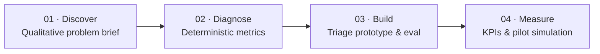
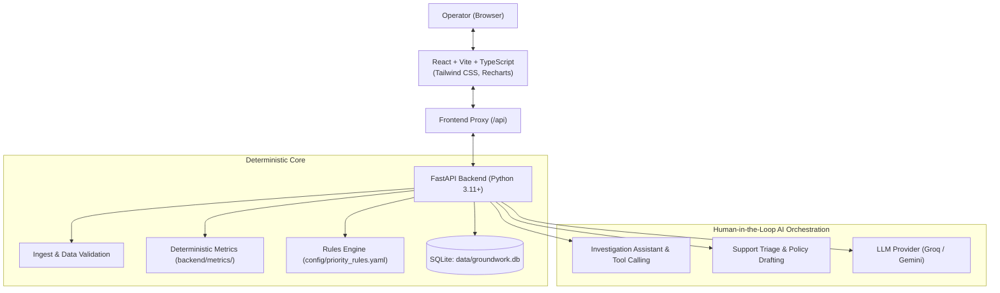

# Groundwork

Groundwork is an AI-assisted business operations intelligence workspace. It guides an operator from an unstructured, vague client problem through four rigorous, evidence-backed stages: **Discover**, **Diagnose**, **Build**, and **Measure**. 

The initial operational scenario models customer support operations for a **fictional** direct-to-consumer home-goods brand (**"Kora Living"**). **All data in this workspace is synthetic and explicitly labelled as such.** Deterministic, unit-tested Python functions compute every metric, percentage, and baseline; no customer-facing message is ever sent autonomously; and every consequential decision requires human approval and audit logging.

---

## The Four Stages



1. **Stage 01: Discover (`/discovery`)** — Ingests verbatim stakeholder interview notes, identifies operational themes, and drafts a structured, version-controlled problem brief with automated quote-verification and claim-hedging checks.
2. **Stage 02: Diagnose (`/diagnostics`)** — Ingests support ticket exports (validating against 13 required columns), computes 18 deterministic metrics across latency, volume, backlog, and reassignments, and provides an investigation assistant grounded strictly in tool outputs.
3. **Stage 03: Build (`/prototypes`)** — Implements an automated support triage prototype: zero-shot intent and signal classification, deterministic priority/queue routing rules, policy-grounded response drafts with placeholder brackets, human proposal approval inbox, and an automated 150-ticket evaluation benchmarking suite.
4. **Stage 04: Measure (`/outcomes`)** — Tracks 6 core KPIs against computed baselines, prioritises candidate operational interventions using multi-criteria weighted scoring, executes a Monte Carlo pilot simulation with confidence intervals, and synthesizes a human-confirmed executive outcome review.

---

## Architecture



---

## Non-Negotiable Rules (R1–R12)

Groundwork operates under twelve strict non-negotiable architectural rules:
The LLM never calculates, estimates, or invents business metrics; all numbers come from deterministic, unit-tested Python functions in `backend/metrics/` (**R1**). Every agent finding must reference the tool call(s) that produced its figures (**R2**). No customer-facing message is ever sent; the agent proposes, a human approves, edits, or rejects, and every decision is written to the audit log (**R3**). Business logic is strictly separated from AI orchestration (**R4**). Agent tools validate arguments with Pydantic and return structured errors (**R5**). `data/answer_key.json` is for generator tests only and is never read or exposed by the app (**R6**). Simulated and synthetic results must be visibly labelled wherever they appear (**R7**). Draft replies use only `knowledge/policies.md` and ticket content, converting unknown facts into bracketed placeholders (**R8**). The UI strictly adheres to the warm-neutral design system, light theme, Inter + Instrument Serif typography, and shared components (**R9**). Every screen implements loading, empty, error, and success states (**R10**). Pytest unit tests cover every metrics function and tool with mocked LLMs (**R11**). Git commits and history are managed manually, never building ahead of prompt scope, and logging changes to `docs/build-log.md` (**R12**).

---

## Quick Start

### 1. Run with Docker Compose (Recommended)

```powershell
docker compose build
docker compose up -d
```

- **Frontend Application:** `http://localhost:5173`
- **Proxied API Health Check:** `http://localhost:5173/api/health`
- **Direct Backend API:** `http://localhost:8000/api/health`

To stop containers:
```powershell
docker compose down
```

### 2. Run Natively (Windows PowerShell)

**Backend (Python 3.11+):**
```powershell
python -m venv backend\.venv
backend\.venv\Scripts\python.exe -m pip install -r backend\requirements.txt
Push-Location backend
.\.venv\Scripts\python.exe -m uvicorn app.main:app --reload --port 8000
Pop-Location
```

**Frontend (Node.js 20+):**
```powershell
Push-Location frontend
npm ci
npm run dev
Pop-Location
```

---

## Configuration Reference

Copy `.env.example` to `.env` to configure settings (the application starts cleanly even if `LLM_API_KEY` is unset):

| Variable | Default | Description |
| :--- | :--- | :--- |
| `APP_ENV` | `development` | Runtime environment (`development`, `production`, `test`). |
| `DATABASE_URL` | `sqlite:///./data/groundwork.db` | SQLite connection URL anchored to repo root. |
| `SEED_ON_START` | `false` | Automatically runs the idempotent Kora Living seed on backend startup. |
| `LLM_PROVIDER` | `groq` | LLM provider adapter (`groq` or `gemini`). |
| `LLM_API_KEY` | `""` | Provider API authentication key (never committed or printed). |
| `LLM_MODEL` | `openai/gpt-oss-20b` | Target LLM model identifier. |
| `LLM_TIMEOUT_SECONDS` | `60` | HTTP request timeout for LLM provider API calls. |
| `LLM_MAX_RETRIES` | `2` | Maximum retry attempts for transient provider failures. |
| `LLM_MAX_OUTPUT_TOKENS` | `2500` | Max generation tokens for assistant and triage classification. |
| `LLM_DISCOVERY_MAX_OUTPUT_TOKENS` | `6000` | Max generation tokens for structured Discovery brief generation. |
| `LLM_OUTCOMES_MAX_OUTPUT_TOKENS` | `4000` | Max generation tokens for Outcome review generation. |
| `LLM_REASONING_EFFORT` | `low` | Reasoning effort level for reasoning models (`low`, `medium`, `high`). |
| `EVAL_PACING_SECONDS` | `2` | Pacing delay between tickets during evaluation runs. |
| `EVAL_MAX_RATE_LIMIT_WAITS` | `3` | Max rate-limit pause attempts before pausing evaluation run. |
| `EVAL_MAX_WAIT_SECONDS` | `120` | Max backoff wait in seconds per rate-limit event. |
| `CORS_ORIGINS` | `["http://localhost:5173", ...]` | Allowed origins for backend CORS middleware. |
| `VITE_API_PROXY_TARGET` | `http://localhost:8000` | Target URL for the Vite frontend development proxy. |

---

## Demo Preparation CLI

Prepare the workspace for a live demo deterministically without making any LLM calls:

```powershell
backend\.venv\Scripts\python.exe -m app.demo prepare [--reset-outcomes] [--clear-proposals] [--yes]
```

- `prepare`: Ensures demo engagement 1 exists, ensures exactly 1 active sample dataset, seeds 6 catalogue KPIs with computed baselines, and ensures 4 seeded interventions exist.
- `--reset-outcomes --yes`: Clears human interventions, pilot simulations, and outcome reviews.
- `--clear-proposals --yes`: Removes existing triage proposals so the sample ticket can be triaged fresh.
- *Invariance:* Never modifies or deletes `EvalRun` or `EvalItem` rows.

---

## Running Verification Tests

### Backend Tests (pytest with 90% coverage gate)
```powershell
Push-Location backend
.\.venv\Scripts\python.exe -m pytest --cov=app --cov-fail-under=90 -q
Pop-Location
```

### Frontend Tests (Vitest inside Docker)
```powershell
docker compose exec -T frontend npm run test
docker compose exec -T frontend npm run typecheck
docker compose exec -T frontend npm run build
```

---

## Documentation Index

- [`AGENTS.md`](./AGENTS.md) — Operational instructions, stack rules, and R1–R12 non-negotiables.
- [`docs/project-brief.md`](./docs/project-brief.md) — Executive product scope and requirements.
- [`docs/design-system.md`](./docs/design-system.md) — UI design tokens, components, accessibility, and quality checklist.
- [`docs/data-dictionary.md`](./docs/data-dictionary.md) — Ticket data schema, categories, signals, and routing queues.
- [`docs/discovery.md`](./docs/discovery.md) — Discovery workspace architecture and grounding rules.
- [`docs/metrics.md`](./docs/metrics.md) — Exact mathematical formulas and scopes for all 18 deterministic metrics.
- [`docs/agent.md`](./docs/agent.md) — Investigation assistant architecture, tool definitions, and error handling.
- [`docs/evaluation.md`](./docs/evaluation.md) — Evaluation harness methodology, Wilson intervals, and slice definitions.
- [`docs/evaluation-results.md`](./docs/evaluation-results.md) — Baseline benchmark results across the 150-ticket eval set.
- [`docs/outcomes.md`](./docs/outcomes.md) — Outcomes stage guide, KPI baselines, and Monte Carlo pilot simulation.
- [`docs/case-study.md`](./docs/case-study.md) — Comprehensive Kora Living customer support operations case study.
- [`docs/demo-script.md`](./docs/demo-script.md) — 5-minute timed live walkthrough script with fallbacks and client FAQs.
- [`docs/manual-checks.md`](./docs/manual-checks.md) — Visual and responsive verification checklist across 375, 768, and 1280 px.
- [`docs/build-log.md`](./docs/build-log.md) — Chronological development log across all prompts.

---

## Limitations and Non-Goals

1. **No Autonomous Dispatch:** Groundwork will never automatically send an email or webhook to a customer. An operator must review and confirm every proposed action.
2. **Synthetic Data Focus:** All pre-packaged operational logs belong to fictional retailer Kora Living. The app is designed for demonstration, benchmarking, and prototyping before production CRM integration.
3. **No Metric Calculation via LLM:** Prompts are explicitly barred from computing aggregations or trends. All quantitative statements must be backed by deterministic Python functions.
4. **Desktop-First Optimization:** While fully responsive down to 375 px mobile viewports, complex multi-column diagnostic tables and slice matrices are optimized for 1280 px+ operational workstations.
